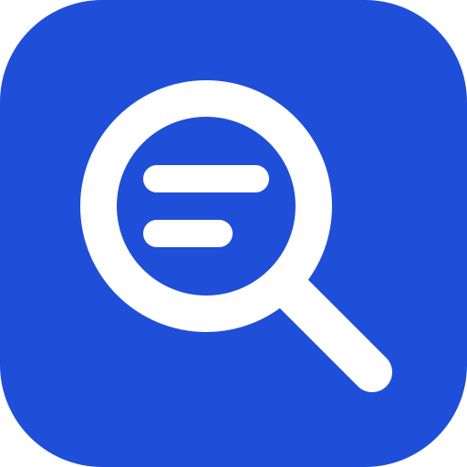
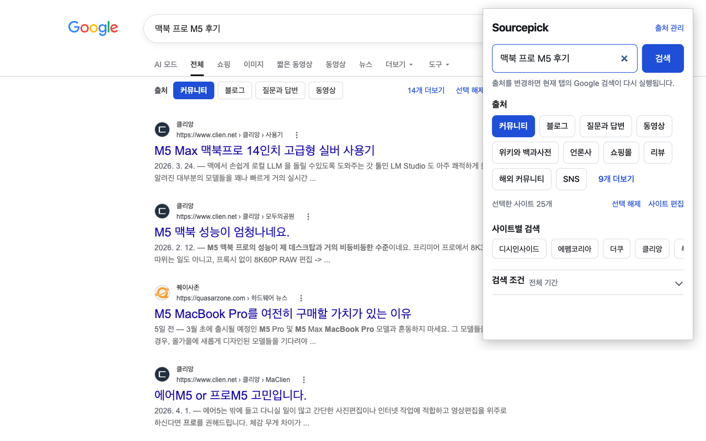
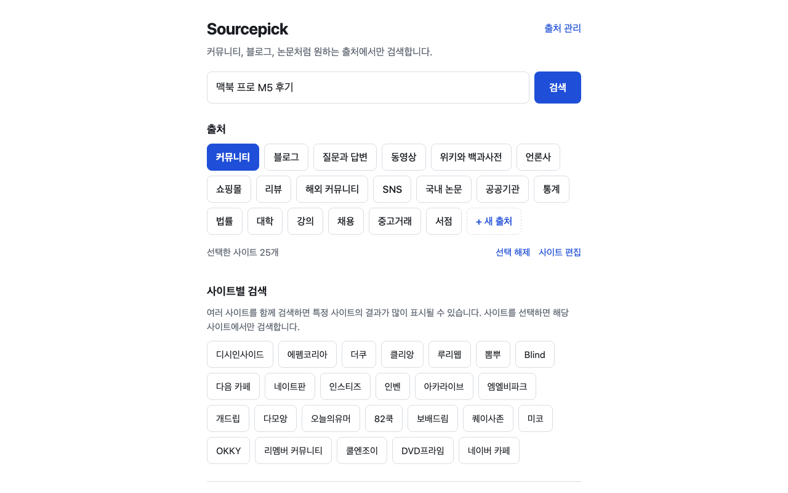
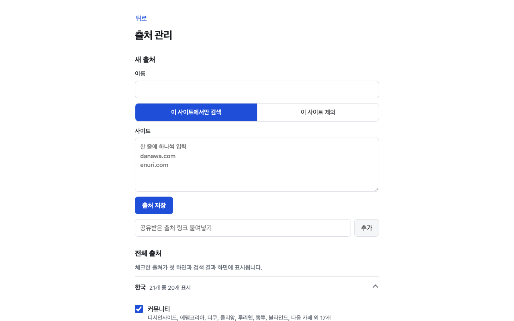

<p align="center"></p>

<h1 align="center">Sourcepick</h1>

<p align="center">
  <strong>원하는 출처의 검색 결과만 볼 수 있습니다.</strong><br>
  커뮤니티, 블로그, 지식iN 같은 질문과 답변, 실사용 리뷰, 논문, 공공기관, 해외 포럼을 버튼 하나로 골라 구글, Bing, DuckDuckGo, Brave에서 검색합니다.
</p>

<p align="center">웹 앱과 크롬, 파이어폭스 확장 프로그램을 제공합니다. 기본 출처 69개에 사이트 793곳이 들어 있습니다. 회원가입, 서버, 추적, 실행에 필요한 외부 패키지가 없습니다.</p>

<p align="center">
  <a href="https://github.com/dooly6276/sourcepick/actions/workflows/ci.yml"></a>
  <a href="https://github.com/dooly6276/sourcepick/releases/latest"></a>
  <a href="https://sourcepick.toolnjoy.com/"></a>
  <a href="LICENSE"></a>
  <br>
  
  
  
  
  
</p>

<p align="center">
  <a href="https://sourcepick.toolnjoy.com/"><strong>웹 앱 열기</strong></a> &nbsp;|&nbsp;
  <a href="https://github.com/dooly6276/sourcepick/releases/latest">확장 프로그램 다운로드</a> &nbsp;|&nbsp;
  <a href="#기본-출처">전체 출처 보기</a>
</p>

<p align="center">
  
</p>

<p align="center"><sub><a href="README.md">English</a></sub></p>

## 무엇이 달라지나요

| Sourcepick 없이 | Sourcepick으로 |
|---|---|
| 검색어 뒤에 '디시', '더쿠'를 붙여 검색해도 블로그 홍보 글과 쇼핑 글이 먼저 나옵니다. | **커뮤니티**를 선택하면 디시인사이드, 에펨코리아, 더쿠, 클리앙, 루리웹 등 커뮤니티 25곳에서만 검색합니다. |
| `site:a.com OR site:b.com ...`을 직접 입력하면 검색창이 연산자로 가득 차 검색어를 고치기 어렵습니다. | 버튼 하나로 사이트가 적용됩니다. 검색창과 탭 제목에는 입력한 검색어만 표시되고, 그 검색창에서 다시 검색해도 출처가 유지됩니다. |
| 검색어가 길어지면 검색엔진이 뒷부분을 알리지 않고 무시해, 넣은 사이트 절반이 검색되지 않습니다. | 검색할 때마다 검색엔진 한도에 맞춥니다. 그래도 넘치면 몇 곳으로 검색했는지 표시하고 나머지는 사이트별로 검색할 수 있게 안내합니다. |
| 큰 사이트 한 곳의 결과가 첫 페이지를 다 차지합니다. | 선택한 사이트마다 따로 검색할 수 있습니다. |
| 자주 찾는 사이트 목록을 메모장에 따로 적어 둡니다. | 내 출처로 저장하고 순서를 바꾸고, 링크로 공유할 수 있습니다. |

## 만든 이유

검색 결과 상단은 검색 순위를 노리고 쓴 글이 차지하고, 실제 사용자의 글과 원문 자료는 뒤로 밀립니다. 느낌만이 아닙니다.

- Dmitri Brereton은 2022년 글 [Google Search Is Dying](https://dkb.blog/p/google-search-is-dying)에서, 많은 사람이 상위 결과보다 실제 사람들의 대화를 믿기 때문에 검색어 뒤에 "reddit"을 붙여 검색한다고 썼습니다. 이 글은 Hacker News 1위에 올랐습니다.
- 논문 [Is Google Getting Worse?](https://link.springer.com/chapter/10.1007/978-3-031-56063-7_4)(Bevendorff 외, ECIR 2024)는 상품 리뷰 검색어 7,392개를 1년 동안 구글, Bing, DuckDuckGo에서 추적했습니다. 상위 결과가 제휴 마케팅과 강하게 연관되어 있고, 검색엔진이 SEO 스팸을 따라잡지 못하고 있다는 결과가 나왔습니다.

많은 사람이 이미 쓰는 해결책은 `site:`입니다. 모든 검색엔진에서 되지만 사이트 20곳을 매번 입력하고, 질문마다 어떤 사이트가 좋은지 기억하고, 몇 곳까지 넣어야 검색엔진이 무시하지 않는지 따지기는 어렵습니다. Sourcepick이 이 일을 대신합니다.

## 화면

<table>
  <tr>
    <td width="33%"></td>
    <td width="33%"></td>
    <td width="33%"></td>
  </tr>
  <tr>
    <td align="center"><sub>확장 프로그램 팝업</sub></td>
    <td align="center"><sub>웹 앱</sub></td>
    <td align="center"><sub>출처 관리</sub></td>
  </tr>
</table>

## 기능

| | |
|---|---|
| **검색 결과 화면에서 바로 선택**<br>확장 프로그램을 설치하면 구글, Bing, DuckDuckGo, Brave 검색 결과 화면에 출처 버튼이 표시됩니다. 버튼을 선택하면 해당 출처로 바뀌고, Ctrl이나 Shift를 누른 채 선택하거나 '여러 출처 함께 선택'을 켜면 여러 출처를 함께 검색합니다. | **깔끔한 검색창**<br>`site:` 연산자는 검색창에 표시하지 않습니다. 검색창과 탭 제목에는 입력한 검색어만 보이고, 검색어를 고쳐 Enter를 누르면 같은 출처로 다시 검색합니다. 직접 입력한 `site:`는 그대로 보입니다. |
| **기본 출처 69개**<br>한국, 일본, 해외 사이트를 커뮤니티, 질문과 답변, 블로그, 리뷰, 논문, 공공기관, 통계, 법률, 채용, 중고거래처럼 글 종류별로 묶었습니다. | **보기 싫은 사이트 제외**<br>웹 전체를 검색할 때 블로그, 언론사, 나무위키, Pinterest, 해외 쇼핑몰 등을 결과에서 뺄 수 있습니다. |
| **내 출처**<br>원하는 사이트로 출처를 만들 수 있습니다. `clien.net/service/board/cm_car`처럼 게시판 주소도 됩니다. 어떤 출처든 링크로 공유할 수 있습니다. | **사이트별 검색**<br>큰 사이트 한 곳이 결과를 다 차지하면, 선택한 사이트마다 따로 검색할 수 있습니다. |
| **검색엔진 한도에 맞춤**<br>검색엔진이 실제로 읽는 길이에 맞춰 검색어를 줄이고, 몇 곳으로 검색했는지 알려 줍니다. 기간 설정과 구글 포럼 탭은 그대로 유지됩니다. | **주소창 검색**<br>확장 프로그램을 설치하면 주소창에 `sp`와 스페이스를 입력한 뒤 검색합니다. PC 브라우저와 Android 크롬에서는 웹 앱을 검색엔진으로 설정할 수도 있습니다. 두 방법 모두 마지막으로 선택한 출처로 검색합니다. |
| **휴대폰에서 사용**<br>웹 앱을 홈 화면에 설치하면 앱처럼 열 수 있습니다. Android에서는 다른 앱에서 글자를 선택하고 공유에서 Sourcepick을 선택하면 바로 검색합니다. 삼성 인터넷과 Android 크롬에서 확인했습니다. | **한국어, 영어, 일본어**<br>화면 언어는 브라우저 언어를 따르고, 언어에 맞는 출처가 먼저 표시됩니다. 다른 나라 출처는 출처 관리에서 선택할 수 있습니다. |

## 설치

| 사용 환경 | 방법 |
|---|---|
| 휴대폰과 그 밖의 브라우저 | [웹 앱](https://sourcepick.toolnjoy.com/)을 열고 홈 화면에 추가합니다. |
| 툴앤조이 | 설치 없이 [툴앤조이 사이트 지정 검색](https://toolnjoy.com/site-search)에서도 같은 한국 출처로 구글 검색을 할 수 있습니다. |
| 크롬, 엣지, 웨일, Brave, 오페라 | Chrome 웹 스토어(준비 중). 지금은 [최신 릴리스](https://github.com/dooly6276/sourcepick/releases/latest)에서 `sourcepick-chrome-*.zip`을 받아 압축을 풀고, `chrome://extensions`에서 개발자 모드를 켠 뒤 '압축해제된 확장 프로그램을 로드합니다'를 선택합니다. |
| 파이어폭스(PC, Android) | Firefox 부가 기능(준비 중). 지금은 PC에서 `sourcepick-firefox-*.zip`을 받아 `about:debugging`의 '이 Firefox'에서 '임시 부가 기능 로드'를 선택합니다. |

### 휴대폰 홈 화면에 추가

- 삼성 인터넷: 주소창의 설치 아이콘(↓)을 선택하고 '추가'를 선택합니다. 아이콘이 없으면 오른쪽 하단 메뉴에서 '현재 페이지 추가', '웹 앱으로 설치'를 차례로 선택합니다. Google Play 프로텍트 창이 표시되면 '앱 검사'를 선택한 뒤 '설치'를 선택합니다.
- Android 크롬: 오른쪽 상단 메뉴에서 '설치 및 바로가기 만들기'를 선택하고 '설치'를 선택합니다.
- iPhone 사파리: 공유 버튼을 선택하고 '홈 화면에 추가'를 선택합니다.

### 직접 빌드

```bash
git clone https://github.com/dooly6276/sourcepick.git
cd sourcepick
npm install
npm run build        # dist/web, dist/chrome, dist/firefox 생성
```

실행에 필요한 패키지는 없습니다. 빌드에는 Node 24 이상과 TypeScript가 필요하며 `npm install`로 설치합니다.

## 기본 출처

출처 69개, 사이트 793곳입니다. 출처마다 [`lenses/`](lenses) 폴더의 JSON 파일 하나라서 빠진 사이트는 한 줄로 추가할 수 있습니다.

<details open>
<summary><strong>한국</strong>: 출처 21개</summary>

| 출처 | 사이트 수 | 포함 사이트 |
|---|---:|---|
| 커뮤니티 | 25 | 디시인사이드, 에펨코리아, 더쿠, 클리앙, 루리웹, 뽐뿌 외 |
| 블로그 | 11 | 네이버 블로그, 티스토리, 브런치스토리, velog, Blogger, WordPress.com 외 |
| 질문과 답변 | 11 | 네이버 지식iN, 아하, 하이닥 건강 Q&A, 로톡 상담 사례, OKKY Q&A, 인프런 질문 외 |
| 동영상 | 10 | 유튜브, 네이버TV, 치지직, SOOP, 카카오TV, 틱톡 외 |
| 위키와 백과사전 | 11 | 나무위키, 위키백과, 네이버 지식백과, 다음백과, 한국민족문화대백과, 두산백과 외 |
| 언론사 | 25 | 연합뉴스, 조선일보, 중앙일보, 동아일보, 한겨레, 경향신문 외 |
| 쇼핑몰 | 25 | 다나와, 에누리, 쿠팡, 네이버쇼핑, 스마트스토어, 11번가 외 |
| 리뷰 | 13 | 다이닝코드, 캐치테이블, 식신, 화해, 글로우픽, 왓챠피디아 외 |
| 국내 논문 | 8 | DBpia, RISS, KCI, ScienceON, earticle, KISS 외 |
| 공공기관 | 15 | 정부 및 공공기관(go.kr), 연구기관(re.kr), 정책브리핑, 국가통계포털, 한국은행, 금융감독원 외 |
| 통계 | 11 | 국가통계포털, e-나라지표, 공공데이터포털, 통계청, 한국은행 경제통계, 서울 열린데이터광장 외 |
| 법률 | 11 | 국가법령정보센터, 찾기쉬운 생활법령정보, 케이스노트, 대한법률구조공단, 대법원, 헌법재판소 외 |
| 대학 | 4 | 국내 대학, 미국 대학, 영국 대학, 일본 대학 |
| 강의 | 10 | 인프런, 클래스101, 패스트캠퍼스, KOCW, K-MOOC, EBSi 외 |
| 채용 | 13 | 사람인, 잡코리아, 원티드, 잡플래닛, 캐치, 링커리어 외 |
| 중고거래 | 5 | 당근, 번개장터, 중고나라, 중고나라 카페, 후루츠패밀리 |
| 서점 | 5 | 예스24, 알라딘, 교보문고, 리디, 밀리의 서재 |
| 레시피 | 3 | 만개의레시피, 우리의식탁, 쿡패드 |
| 블로그 제외 | 4 | 제외: 네이버 블로그, 티스토리, 브런치스토리, 네이버 포스트 |
| 언론사 제외 | 16 | 제외: news.naver.com, v.daum.net, news.nate.com, yna.co.kr, chosun.com, joongang.co.kr 외 |
| 나무위키 제외 | 1 | 제외: 나무위키 |

</details>

<details>
<summary><strong>해외</strong>: 출처 29개</summary>

| 출처 | 사이트 수 | 포함 사이트 |
|---|---:|---|
| 해외 커뮤니티 | 25 | Reddit, Hacker News, Lobsters, Tildes, Lemmy.world, Lemmy.ml 외 |
| Reddit | 1 | Reddit |
| 해외 질문과 답변 | 16 | Quora, Stack Exchange, Stack Overflow, Super User, Ask Ubuntu, Server Fault 외 |
| 해외 블로그 | 14 | Substack, Medium, WordPress.com, Blogger, Ghost, Hashnode 외 |
| 해외 동영상 | 11 | YouTube, Vimeo, TikTok, Twitch, Dailymotion, TED 외 |
| 해외 위키와 백과사전 | 18 | Wikipedia, Fandom, wikiHow, Wikivoyage, Wiktionary, Wikibooks 외 |
| 해외 언론사 | 25 | Reuters, AP News, BBC, The New York Times, The Washington Post, The Guardian 외 |
| 해외 쇼핑몰 | 25 | Amazon, eBay, Walmart, Target, Best Buy, Etsy 외 |
| 해외 리뷰 | 25 | RTINGS, Wirecutter, Consumer Reports, Notebookcheck, GSMArena, DPReview 외 |
| SNS | 9 | X, Threads, Bluesky, Mastodon, Instagram, LinkedIn 외 |
| 해외 논문 | 25 | arXiv, PubMed, Semantic Scholar, ResearchGate, SSRN, JSTOR 외 |
| 해외 공공기관 | 12 | .gov, GOV.UK, EU, UN, WHO, OECD 외 |
| 해외 통계 | 20 | Our World in Data, Statista, World Bank Data, OECD Data, OECD Data Explorer, U.S. Census Bureau 외 |
| 해외 법률 | 18 | Cornell LII, Justia, FindLaw, CourtListener, U.S. Supreme Court, Congress.gov 외 |
| 해외 대학 | 6 | US universities (.edu), UK universities (.ac.uk), Australian universities (.edu.au), New Zealand universities (.ac.nz), Japanese universities (.ac.jp), Korean universities (.ac.kr) |
| 해외 강의 | 17 | Coursera, edX, Khan Academy, Udemy, MIT OpenCourseWare, FutureLearn 외 |
| 해외 채용 | 20 | LinkedIn Jobs, Indeed, Glassdoor, ZipRecruiter, Monster, SimplyHired 외 |
| 해외 중고거래 | 18 | eBay, Craigslist, Facebook Marketplace, OfferUp, Mercari, Poshmark 외 |
| 해외 서점 | 16 | Goodreads, Bookshop.org, Barnes & Noble, Project Gutenberg, Open Library, Internet Archive 외 |
| 해외 레시피 | 20 | Serious Eats, Allrecipes, BBC Good Food, Budget Bytes, Food52, NYT Cooking 외 |
| 해외 여행 | 16 | Tripadvisor, Lonely Planet, Wikivoyage, FlyerTalk, r/travel, Rick Steves 외 |
| 개발 | 16 | Stack Overflow, GitHub, DEV Community, Hacker News, Lobsters, Medium 외 |
| 공식 문서 | 12 | MDN, Microsoft Learn, Python, Node.js, React, Go 외 |
| 오픈소스 | 7 | GitHub, GitLab, Codeberg, SourceForge, SourceHut, npm 외 |
| 디자인 | 8 | Dribbble, Behance, Awwwards, Figma Community, Mobbin, Land-book 외 |
| Pinterest 제외 | 4 | 제외: Pinterest |
| Quora 제외 | 1 | 제외: Quora |
| 해외 쇼핑몰 제외 | 14 | 제외: Amazon, eBay, Walmart, Target, Best Buy, Etsy 외 |
| 해외 언론사 제외 | 16 | 제외: cnn.com, foxnews.com, nytimes.com, washingtonpost.com, theguardian.com, bbc.com 외 |

</details>

<details>
<summary><strong>일본</strong>: 출처 19개</summary>

| 출처 | 사이트 수 | 포함 사이트 |
|---|---:|---|
| 일본 커뮤니티 | 18 | 5ちゃんねる, おーぷん2ちゃんねる, ふたば☆ちゃんねる, したらば掲示板, ガールズちゃんねる, 発言小町 외 |
| 일본 질문과 답변 | 8 | Yahoo!知恵袋, OKWAVE, teratail, スタック・オーバーフロー, 弁護士ドットコム, アスクドクターズ 외 |
| 일본 블로그 | 15 | note, アメブロ, はてなブログ, ライブドアブログ, FC2, はてなダイアリー 외 |
| 일본 동영상 | 9 | YouTube, ニコニコ動画, TikTok, ABEMA, TVer, Twitch 외 |
| 일본 위키와 사전 | 10 | ウィキペディア, ピクシブ百科事典, ニコニコ大百科, コトバンク, Weblio, WIKIWIKI 외 |
| 일본 언론사 | 25 | Yahoo!ニュース, NHK, 朝日新聞, 毎日新聞, 読売新聞, 日本経済新聞 외 |
| 일본 쇼핑몰 | 20 | Amazon, 楽天市場, Yahoo!ショッピング, 価格.com, ヨドバシ.com, ビックカメラ.com 외 |
| 일본 리뷰 | 17 | 価格.com, 食べログ, @cosme, みん評, Filmarks, 映画.com 외 |
| 일본 논문 | 6 | CiNii Research, J-STAGE, IRDB, researchmap, 国立国会図書館サーチ, KAKEN |
| 일본 공공기관 | 5 | 官公庁(go.jp), 自治体(lg.jp), 日本銀行, 日本取引所グループ, NHK |
| 일본 법률 | 9 | e-Gov法令検索, 裁判所, 弁護士ドットコム, 法テラス, 法務省, 衆議院 외 |
| 일본 채용 | 15 | Indeed, リクナビ, マイナビ, doda, ビズリーチ, エン転職 외 |
| 일본 중고거래 | 11 | メルカリ, 楽天ラクマ, ヤフオク!, Yahoo!フリマ, ジモティー, セカンドストリート 외 |
| 일본 서점 | 13 | honto, 紀伊國屋書店, 読書メーター, ブクログ, 青空文庫, カーリル 외 |
| 일본 레시피 | 11 | クックパッド, クラシル, デリッシュキッチン, 白ごはん.com, 楽天レシピ, みんなのきょうの料理 외 |
| 일본 개발 | 10 | Qiita, Zenn, teratail, @IT, CodeZine, gihyo.jp 외 |
| 일본 정리 블로그 제외 | 11 | 제외: はちま起稿 / オレ的ゲーム速報, はちま起稿, ハムスター速報, アルファルファモザイク, 痛いニュース, VIPPERな俺 외 |
| 야후 지혜주머니 제외 | 1 | 제외: Yahoo!知恵袋 |
| 일본 언론사 제외 | 15 | 제외: Yahoo!ニュース, NHK, 朝日新聞, 毎日新聞, 読売新聞, 日本経済新聞 외 |

</details>

## 동작 방식

출처는 사이트 목록입니다. 출처를 선택하면 주요 검색엔진이 모두 지원하는 검색 연산자를 검색어 끝에 추가합니다.

```
아이폰 17 후기 site:dcinside.com OR site:theqoo.net -site:news.naver.com
```

검색 결과 화면의 버튼 줄은 주소에서 연산자를 다시 읽어 현재 적용된 출처를 표시합니다. 검색 결과 주소는 일반 검색 주소와 같아서 북마크하거나 공유할 수 있습니다. 기간, 구글 포럼 탭 같은 검색엔진 설정은 그대로 유지됩니다.

검색엔진은 긴 검색어의 뒷부분을 알리지 않고 무시합니다. 2026년 11월에 측정한 한도는 다음과 같고, Sourcepick은 검색할 때마다 이 한도에 맞춥니다.

| 검색엔진 | 실제로 읽는 범위 |
|---|---|
| 구글 | 검색어 단어 수와 사이트 수를 합쳐 앞의 32개(`OR`는 세지 않음) |
| Bing | 사이트 60곳 이상도 적용하지만, 약 1,800자를 넘으면 결과가 몇 개만 나옴 |
| DuckDuckGo | 약 22개, 약 500바이트를 넘으면 검색하지 않음 |
| Brave | 20개, 약 400자를 넘으면 검색하지 않음 |

출처를 선택하면 결과가 해당 사이트에서만 나오므로 제외 조건을 먼저 삭제합니다. 그래도 한도를 넘으면 사이트 몇 곳으로 검색하는지 표시하고, 나머지 사이트는 사이트별 검색으로 안내합니다.

## 다른 방법과 비교

| | 하는 일 | Sourcepick과 다른 점 |
|---|---|---|
| `site:` 직접 입력 | 모든 검색엔진에서 사용 가능 | 같은 연산자를 쓰지만 입력할 필요가 없고, 검색창이 지저분해지지 않고, 몇 곳까지 들어가는지 따질 필요가 없습니다. |
| 구글 포럼 필터 | 어떤 포럼을 보여 줄지 구글이 정함 | 사이트를 직접 고르고, Bing, DuckDuckGo, Brave에서도 쓸 수 있습니다. 한국 커뮤니티도 고를 수 있습니다. |
| [Programmable Search Engine](https://programmablesearchengine.google.com/about/) | 관리 화면에서 사이트를 지정한 구글 검색 페이지 | 관리 화면과 별도 페이지 없이 평소 쓰는 검색 결과 화면에서 버튼으로 출처를 바꿉니다. |
| [uBlacklist](https://github.com/iorate/ublacklist) | 차단한 사이트를 결과에서 숨김 | 고른 사이트로 검색 범위를 좁히고, 사이트 제외도 할 수 있습니다. 두 확장 프로그램을 함께 써도 됩니다. |
| [Kagi 렌즈](https://help.kagi.com/kagi/features/lenses.html) | 유료 검색엔진 Kagi 안의 사이트 목록 | 무료이고 지금 쓰는 검색엔진에서 그대로 씁니다. |

## 자주 묻는 질문

**Sourcepick이 내 검색어를 보나요?**
아닙니다. Sourcepick 서버는 없습니다. 모든 동작은 브라우저 안에서 이루어지고, 설정도 브라우저에만 저장되며, 검색어는 선택한 검색엔진으로만 전송됩니다.

**검색창에 `site:`가 안 보이고 검색어만 보입니다.**
의도한 동작입니다. 적용된 출처는 버튼으로 표시되므로 검색창은 깔끔하게 둡니다. 연산자는 페이지 주소에 그대로 있고, 검색창에서 다시 검색해도 같은 출처가 유지됩니다. 직접 입력한 `site:`는 그대로 보입니다.

**출처에 있는 사이트보다 적은 곳에서만 결과가 나옵니다.**
대부분 검색엔진 한도 때문입니다([동작 방식](#동작-방식) 참고). Sourcepick이 몇 곳으로 검색했는지 표시하니, 나머지는 '사이트별 검색'을 이용해 주세요. 검색어에 맞는 글이 적은 사이트도 있습니다.

**특정 게시판이나 카페만 검색할 수 있나요?**
네. 내 출처에 `clien.net/service/board/cm_car`나 `reddit.com/r/BuyItForLife`처럼 게시판 주소를 추가하면 됩니다.

**아이폰에서도 쓸 수 있나요?**
네. 사파리에서 웹 앱을 열고 '홈 화면에 추가'를 선택하면 됩니다. 사파리 확장 프로그램은 아직 없습니다.

**검색엔진 화면이 바뀌면 어떻게 되나요?**
검색엔진마다 버튼 줄을 넣을 자리를 여러 곳 준비해 두었습니다. 버튼 줄이 표시되지 않더라도 검색은 일반 검색 주소라서 그대로 됩니다. 버튼 줄이 사라지면 [이슈](https://github.com/dooly6276/sourcepick/issues)로 알려 주세요.

## 한계

- 검색엔진이 읽는 검색어 길이에 한도가 있어, 사이트가 많은 출처는 DuckDuckGo와 Brave에서 일부만 검색됩니다. 이때는 화면에 안내가 표시됩니다.
- Chrome 웹 스토어와 Firefox 부가 기능 등록은 준비 중입니다. 그 전까지는 릴리스 zip 파일로 설치합니다.
- 사파리 확장 프로그램은 아직 없습니다. 아이폰과 맥에서는 웹 앱을 이용해 주세요.
- 검색 결과 화면의 버튼 줄은 검색엔진 화면 구조에 맞춰 넣으므로, 검색엔진이 화면을 크게 바꾸면 업데이트가 필요할 수 있습니다.

## 참여하기

Sourcepick은 일부러 작게 만들었습니다. strict TypeScript, 실행에 필요한 외부 패키지 없음, `npm test` 하나로 검사합니다.

- **출처 추가**: 가장 큰 가치는 좋은 사이트 목록에서 나옵니다. 빠진 사이트나 나라가 있으면 [`lenses/`](lenses) 폴더에 JSON 파일을 추가해 풀 리퀘스트를 보내 주세요. 방법은 [CONTRIBUTING.md](CONTRIBUTING.md)에 있습니다. 코드를 고치기 어려우면 사이트 목록만 [이슈](https://github.com/dooly6276/sourcepick/issues/new?template=new_source.yml)로 남겨 주셔도 됩니다.
- **번역**: 화면은 영어, 한국어, 일본어를 지원합니다. 언어 추가는 `src/i18n.ts`에 묶음 하나를 더하면 됩니다.
- **검색엔진과 브라우저**: Startpage, Ecosia, 아이폰과 맥용 사파리 확장 프로그램은 [도움을 기다리고 있습니다](https://github.com/dooly6276/sourcepick/labels/help%20wanted).

구조와 검색엔진, 언어를 추가하는 방법은 [docs/ARCHITECTURE.md](docs/ARCHITECTURE.md)에 있습니다. 질문과 아이디어는 [Discussions](https://github.com/dooly6276/sourcepick/discussions)에 남겨 주세요.

```bash
npm run typecheck      # strict TypeScript 검사
npm test               # 단위 시험과 출처 파일 검사
npm run check-domains  # lenses/의 모든 사이트가 열리는지 확인(네트워크 사용)
npm run serve          # 웹 앱을 빌드해 http://127.0.0.1:8791 에서 실행
npm run package        # 확장 프로그램 스토어용 zip 생성
```

## 개인정보

Sourcepick은 서버가 없고 정보를 수집하지 않습니다. 확장 프로그램은 설정 저장(`storage`) 권한과, 출처 버튼을 표시할 구글, Bing, DuckDuckGo, Brave 검색 결과 화면 접근 권한만 사용합니다. 자세한 내용은 [개인정보 처리방침](store/privacy.md)에 있습니다.

## 라이선스

[MIT](LICENSE)
