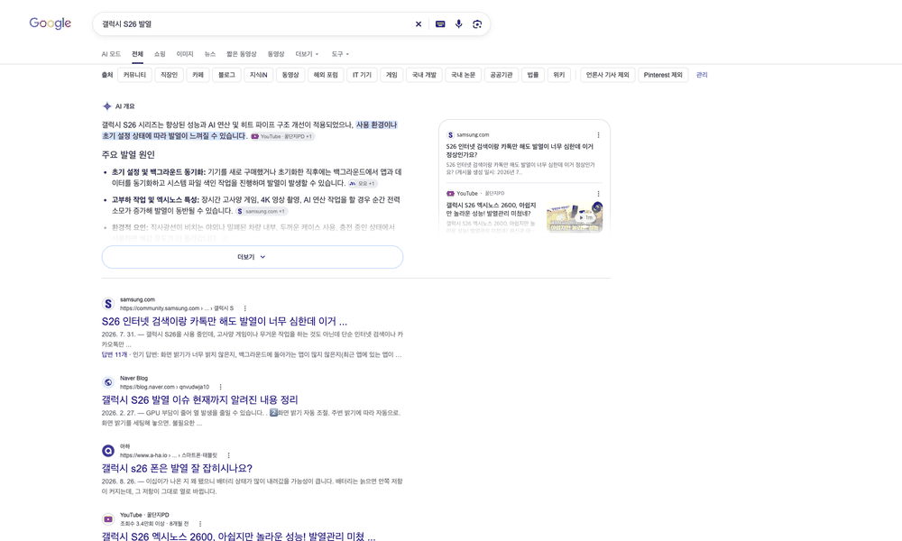

# Sourcepick

**원하는 출처의 검색 결과만 볼 수 있습니다.** 커뮤니티, 블로그, 카페, 논문, 공공기관, 해외 포럼, 공식 문서처럼 원하는 곳을 선택해 구글, DuckDuckGo, Brave에서 검색합니다.

[English](README.md)



구글에서 검색하면 기사와 광고성 글이 상단을 차지해 실제 사용자의 글을 찾기 어렵습니다. `site:dcinside.com OR site:theqoo.net ...`를 매번 입력하면 원하는 결과를 볼 수 있지만 번거롭습니다. Sourcepick은 사이트 목록을 출처로 저장해 두고, 선택 한 번으로 검색에 적용합니다.

- **검색 결과 화면에서 바로 선택**: 확장 프로그램을 설치하면 구글, DuckDuckGo, Brave 검색 결과 화면에 출처 버튼이 표시됩니다. 여러 출처를 함께 선택하거나 언론사 기사, Pinterest 같은 사이트를 제외할 수 있습니다.
- **기본 출처 35개**: 한국, 일본, 해외 사이트를 주제별로 묶어 두었습니다. 출처는 JSON 파일이라 누구나 고칠 수 있습니다.
- **내 출처**: 원하는 사이트로 출처를 만들고 링크로 공유할 수 있습니다. `clien.net/service/board/cm_car`처럼 게시판 주소도 사용할 수 있습니다.
- **휴대폰에서 사용**: 웹 앱을 홈 화면에 설치하면 앱처럼 열 수 있습니다. Android에서는 다른 앱에서 글자를 선택하고 공유에서 Sourcepick을 선택하면 바로 검색합니다. 삼성 인터넷에서 확인했습니다.
- **주소창 검색**: 확장 프로그램에서는 주소창에 `sp`와 공백을 입력한 뒤 검색어를 입력합니다. 웹 앱 주소를 브라우저 검색엔진으로 추가할 수도 있습니다.
- **회원가입, 서버, 추적 없음**: 설정은 브라우저에만 저장됩니다. 검색어는 선택한 검색엔진으로만 전송됩니다.

## 설치

| 사용 환경 | 방법 |
|---|---|
| 크롬, 엣지, 웨일, Brave, 오페라 | Chrome 웹 스토어(준비 중). 지금은 빌드한 뒤 `dist/chrome` 폴더를 압축해제된 확장 프로그램으로 로드합니다. |
| 파이어폭스(PC, Android) | Firefox 부가 기능(준비 중). 지금은 빌드한 뒤 `about:debugging`에서 `dist/firefox/manifest.json`을 로드합니다. |
| 휴대폰과 그 밖의 브라우저 | 웹 앱을 열고 홈 화면에 추가합니다. |

```bash
git clone <저장소 주소>
cd sourcepick
npm run build        # dist/web, dist/chrome, dist/firefox 생성
```

설치할 패키지는 없습니다. Node 18 이상이면 됩니다.

### 휴대폰 홈 화면에 추가

- 삼성 인터넷: 오른쪽 하단 메뉴에서 현재 페이지 추가를 선택하고 웹 앱으로 설치를 선택합니다. Google Play 프로텍트 앱 검사 창이 표시되면 앱 검사를 선택한 뒤 설치를 선택합니다.
- Android 크롬: 오른쪽 상단 메뉴에서 설치 및 바로가기 만들기를 선택하고 설치를 선택합니다.
- iPhone 사파리: 공유 버튼을 선택하고 홈 화면에 추가를 선택합니다.

## 동작 방식

출처는 사이트 목록입니다. 출처를 선택하면 주요 검색엔진이 모두 지원하는 검색 연산자를 검색어 끝에 추가합니다.

```
아이폰 17 후기 site:dcinside.com OR site:theqoo.net -site:news.naver.com
```

검색 결과 화면의 버튼 줄은 주소에서 연산자를 다시 읽어 현재 적용된 출처를 표시합니다. 검색 결과 주소는 일반 검색 주소와 같아서 북마크하거나 공유할 수 있습니다. 기간, 구글 포럼 탭 같은 검색엔진 설정은 그대로 유지됩니다.

2026년 11월 확인 기준으로 구글은 `site:` 26개를 `OR`로 연결한 검색어도 모두 적용했습니다. Bing은 자동 시험에 보안 확인 화면을 표시해 아직 지원하지 않습니다.

## 출처 추가에 참여하기

빠진 사이트나 나라가 있으면 [`lenses/`](lenses) 폴더에 JSON 파일을 추가해 풀 리퀘스트를 보내 주세요. 방법은 [CONTRIBUTING.md](CONTRIBUTING.md)에 있습니다.

## 개인정보

Sourcepick은 서버가 없고 정보를 수집하지 않습니다. 확장 프로그램은 설정 저장(`storage`) 권한과, 출처 버튼을 표시할 구글, DuckDuckGo, Brave 검색 결과 화면 접근 권한만 사용합니다.

## 라이선스

[MIT](LICENSE)
