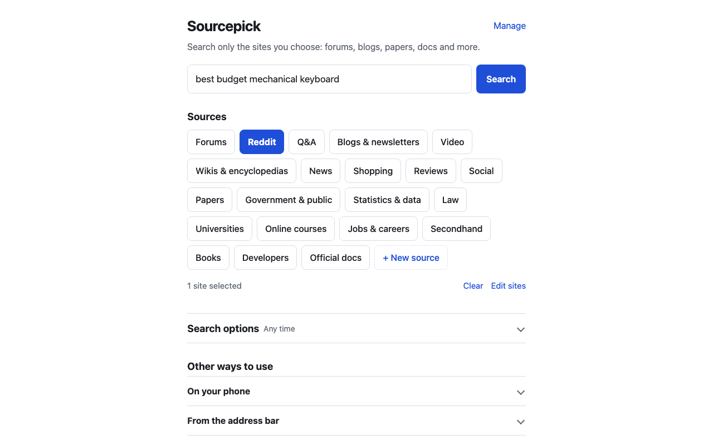
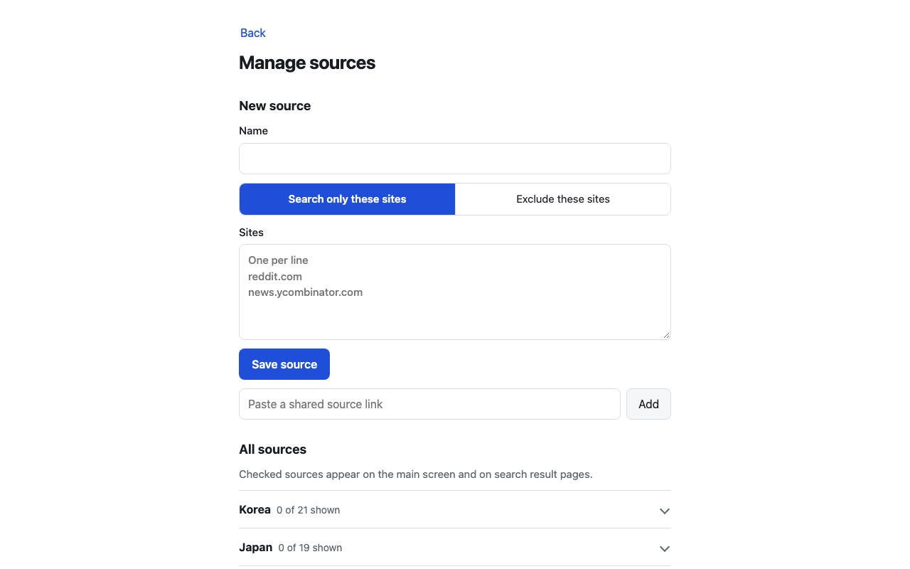

<p align="center"></p>

<h1 align="center">Sourcepick</h1>

<p align="center">
  <strong>Search only the sites you choose.</strong><br>
  Forums, Reddit, official docs, papers, first-hand reviews, Korean communities and Japanese Q&amp;A, one tap away on Google, Bing, DuckDuckGo and Brave Search.
</p>

<p align="center">A web app and a Chrome and Firefox extension. 69 ready-made sources covering 793 sites. No account, no server, no tracking, no runtime dependencies.</p>

<p align="center">
  <a href="https://github.com/dooly6276/sourcepick/actions/workflows/ci.yml"></a>
  <a href="https://github.com/dooly6276/sourcepick/releases/latest"></a>
  <a href="https://sourcepick.toolnjoy.com/"></a>
  <a href="LICENSE"></a>
  <br>
  
  
  
  
  
</p>

<p align="center">
  <a href="https://sourcepick.toolnjoy.com/"><strong>Try the web app</strong></a> &nbsp;|&nbsp;
  <a href="https://chromewebstore.google.com/detail/sourcepick/kifmhnidecbnbidbhdooofggbekanjhc">Add to Chrome</a> &nbsp;|&nbsp;
  <a href="#built-in-sources">See all sources</a>
</p>

<p align="center">
  
</p>

<p align="center"><sub><a href="README.ko.md">한국어</a></sub></p>

## What it fixes

| Without Sourcepick | With Sourcepick |
|---|---|
| You add "reddit" to every search and still get listicles, Pinterest boards and affiliate review sites. | Press **Forums** and the results come from 25 forums at once: Reddit, Hacker News, Lemmy, Tildes, Steam and more. |
| You type `site:a.com OR site:b.com OR ...` by hand, and the search box fills up with operators you have to edit around. | One button applies the sites. The search box and the tab title keep showing only your words, and searching again from that box keeps the same sources. |
| Past a certain length, the engine quietly ignores the end of your query, so half your sites never get searched. | Every query is fitted to that engine's limit. If the chosen sites still do not fit, Sourcepick says how many it searched and offers the rest one by one. |
| One big site fills the whole first page. | Search each site in the selection on its own with one tap. |
| Your list of good sites lives in a notes app. | Save it as your own source, reorder your sources, and share any source as a link. |

## Why this exists

Search engines bury forum threads, first-hand reviews and primary sources under pages written to rank. This is not only a feeling:

- In [Google Search Is Dying](https://dkb.blog/p/google-search-is-dying) (2022), Dmitri Brereton described how many people add "reddit" to their searches because they trust real discussions more than the top results. The post reached the top of Hacker News.
- [Is Google Getting Worse?](https://link.springer.com/chapter/10.1007/978-3-031-56063-7_4) (Bevendorff et al., ECIR 2024) tracked 7,392 product review queries on Google, Bing and DuckDuckGo for a year and found that top results are strongly linked to affiliate marketing, and that the engines keep losing the race against SEO spam.

The fix people already use is `site:`. It works on every engine, but nobody wants to type twenty of them, remember which sites are good for which question, or work out how many fit before the engine starts ignoring them. Sourcepick does that part.

## Screenshots

<table>
  <tr>
    <td width="33%"></td>
    <td width="33%"></td>
    <td width="33%"></td>
  </tr>
  <tr>
    <td align="center"><sub>Extension popup</sub></td>
    <td align="center"><sub>Web app</sub></td>
    <td align="center"><sub>Manage sources</sub></td>
  </tr>
</table>

## Features

| | |
|---|---|
| **Buttons on the results page**<br>The extension adds a row of source buttons to Google, Bing, DuckDuckGo and Brave Search. Press one to switch to it; hold Ctrl or Shift, or turn on multi-select, to combine several. | **A clean search box**<br>The operators stay out of sight. The search box and tab title show only your words, and editing the words and pressing Enter keeps the same sources. A `site:` you typed yourself stays visible. |
| **69 built-in sources**<br>Worldwide, Korean and Japanese sites grouped by kind of content: forums, Q&amp;A, blogs, reviews, papers, government, statistics, law, jobs, secondhand and more. | **Hide what you never want**<br>Exclude sources remove Pinterest, Quora, shopping sites, major news, Japanese matome blogs and more from a whole-web search. |
| **Your own sources**<br>Any list of domains or URL paths. `reddit.com/r/BuyItForLife` or a single board of a forum works. Share any source as a link. | **Search one site at a time**<br>When one big site fills the page, each site in the selection is one tap away. |
| **Fits every engine's limits**<br>Queries are trimmed to what each engine actually reads, with a note on how many sites were searched. Time filters and Google's Forums tab are kept. | **Address bar**<br>Type `sp` and a space (extension), or set the web app as your search engine on desktop or Chrome for Android. It searches with the sources you chose last. |
| **Works on phones**<br>Add the web app to your home screen. On Android, select text in any app and share it to Sourcepick to search it. Tested on Samsung Internet and Chrome for Android. | **English, Korean and Japanese**<br>The interface follows your browser language, and each language starts with sources that suit it. Every region is one tap away in Manage. |

## Install

| Where | How |
|---|---|
| Any phone or browser | Open the [web app](https://sourcepick.toolnjoy.com/) and add it to your home screen. |
| Chrome, Edge, Whale, Brave, Opera | Install from the [Chrome Web Store](https://chromewebstore.google.com/detail/sourcepick/kifmhnidecbnbidbhdooofggbekanjhc). |
| Firefox (desktop and Android) | Firefox Add-ons (coming soon). For now on desktop: download `sourcepick-firefox-*.zip`, open `about:debugging`, This Firefox, Load Temporary Add-on. |

On a phone, the web app is the way in: Samsung Internet, Chrome and Firefox on Android and Safari on iPhone can all add it to the home screen. On Android it also appears in the share sheet, so you can select text in any app and search it with your sources.

To build it yourself:

```bash
git clone https://github.com/dooly6276/sourcepick.git
cd sourcepick
npm install
npm run build        # writes dist/web, dist/chrome, dist/firefox
```

No runtime dependencies. Building needs Node 24 or later and TypeScript, installed by `npm install`.

## Built-in sources

69 sources, 793 sites. Each one is a JSON file in [`lenses/`](lenses), so a missing site is a one-line pull request.

<details open>
<summary><strong>Worldwide</strong>: 29 sources</summary>

| Source | Sites | Includes |
|---|---:|---|
| Forums | 25 | Reddit, Hacker News, Lobsters, Tildes, Lemmy.world, Lemmy.ml, … |
| Reddit | 1 | Reddit |
| Q&A | 16 | Quora, Stack Exchange, Stack Overflow, Super User, Ask Ubuntu, Server Fault, … |
| Blogs & newsletters | 14 | Substack, Medium, WordPress.com, Blogger, Ghost, Hashnode, … |
| Video | 11 | YouTube, Vimeo, TikTok, Twitch, Dailymotion, TED, … |
| Wikis & encyclopedias | 18 | Wikipedia, Fandom, wikiHow, Wikivoyage, Wiktionary, Wikibooks, … |
| News | 25 | Reuters, AP News, BBC, The New York Times, The Washington Post, The Guardian, … |
| Shopping | 25 | Amazon, eBay, Walmart, Target, Best Buy, Etsy, … |
| Reviews | 25 | RTINGS, Wirecutter, Consumer Reports, Notebookcheck, GSMArena, DPReview, … |
| Social | 9 | X, Threads, Bluesky, Mastodon, Instagram, LinkedIn, … |
| Papers | 25 | arXiv, PubMed, Semantic Scholar, ResearchGate, SSRN, JSTOR, … |
| Government & public | 12 | .gov, GOV.UK, EU, UN, WHO, OECD, … |
| Statistics & data | 20 | Our World in Data, Statista, World Bank Data, OECD Data, OECD Data Explorer, U.S. Census Bureau, … |
| Law | 18 | Cornell LII, Justia, FindLaw, CourtListener, U.S. Supreme Court, Congress.gov, … |
| Universities | 6 | US universities (.edu), UK universities (.ac.uk), Australian universities (.edu.au), New Zealand universities (.ac.nz), Japanese universities (.ac.jp), Korean universities (.ac.kr) |
| Online courses | 17 | Coursera, edX, Khan Academy, Udemy, MIT OpenCourseWare, FutureLearn, … |
| Jobs & careers | 20 | LinkedIn Jobs, Indeed, Glassdoor, ZipRecruiter, Monster, SimplyHired, … |
| Secondhand | 18 | eBay, Craigslist, Facebook Marketplace, OfferUp, Mercari, Poshmark, … |
| Books | 16 | Goodreads, Bookshop.org, Barnes & Noble, Project Gutenberg, Open Library, Internet Archive, … |
| Recipes | 20 | Serious Eats, Allrecipes, BBC Good Food, Budget Bytes, Food52, NYT Cooking, … |
| Travel | 16 | Tripadvisor, Lonely Planet, Wikivoyage, FlyerTalk, r/travel, Rick Steves, … |
| Developers | 16 | Stack Overflow, GitHub, DEV Community, Hacker News, Lobsters, Medium, … |
| Official docs | 12 | MDN, Microsoft Learn, Python, Node.js, React, Go, … |
| Open source | 7 | GitHub, GitLab, Codeberg, SourceForge, SourceHut, npm, … |
| Design | 8 | Dribbble, Behance, Awwwards, Figma Community, Mobbin, Land-book, … |
| No Pinterest | 4 | Hides Pinterest |
| No Quora | 1 | Hides Quora |
| No shopping | 14 | Hides Amazon, eBay, Walmart, Target, Best Buy, Etsy, … |
| No major news | 16 | Hides cnn.com, foxnews.com, nytimes.com, washingtonpost.com, theguardian.com, bbc.com, … |

</details>

<details>
<summary><strong>Korea</strong>: 21 sources</summary>

| Source | Sites | Includes |
|---|---:|---|
| Korean communities | 25 | 디시인사이드, 에펨코리아, 더쿠, 클리앙, 루리웹, 뽐뿌, … |
| Korean blogs | 11 | 네이버 블로그, 티스토리, 브런치스토리, velog, Blogger, WordPress.com, … |
| Korean Q&A | 11 | 네이버 지식iN, 아하, 하이닥 건강 Q&A, 로톡 상담 사례, OKKY Q&A, 인프런 질문, … |
| Video (Korea) | 10 | 유튜브, 네이버TV, 치지직, SOOP, 카카오TV, 틱톡, … |
| Korean wikis and encyclopedias | 11 | 나무위키, 위키백과, 네이버 지식백과, 다음백과, 한국민족문화대백과, 두산백과, … |
| Korean news | 25 | 연합뉴스, 조선일보, 중앙일보, 동아일보, 한겨레, 경향신문, … |
| Korean shopping | 25 | 다나와, 에누리, 쿠팡, 네이버쇼핑, 스마트스토어, 11번가, … |
| Korean reviews | 13 | 다이닝코드, 캐치테이블, 식신, 화해, 글로우픽, 왓챠피디아, … |
| Korean papers | 8 | DBpia, RISS, KCI, ScienceON, earticle, KISS, … |
| Korean government | 15 | 정부 및 공공기관(go.kr), 연구기관(re.kr), 정책브리핑, 국가통계포털, 한국은행, 금융감독원, … |
| Korean statistics | 11 | 국가통계포털, e-나라지표, 공공데이터포털, 통계청, 한국은행 경제통계, 서울 열린데이터광장, … |
| Korean law | 11 | 국가법령정보센터, 찾기쉬운 생활법령정보, 케이스노트, 대한법률구조공단, 대법원, 헌법재판소, … |
| Korean universities | 4 | 국내 대학, 미국 대학, 영국 대학, 일본 대학 |
| Korean online courses | 10 | 인프런, 클래스101, 패스트캠퍼스, KOCW, K-MOOC, EBSi, … |
| Korean job sites | 13 | 사람인, 잡코리아, 원티드, 잡플래닛, 캐치, 링커리어, … |
| Korean secondhand | 5 | 당근, 번개장터, 중고나라, 중고나라 카페, 후루츠패밀리 |
| Korean bookstores | 5 | 예스24, 알라딘, 교보문고, 리디, 밀리의 서재 |
| Korean recipes | 3 | 만개의레시피, 우리의식탁, 쿡패드 |
| No Korean blogs | 4 | Hides 네이버 블로그, 티스토리, 브런치스토리, 네이버 포스트 |
| No Korean news | 16 | Hides news.naver.com, v.daum.net, news.nate.com, yna.co.kr, chosun.com, joongang.co.kr, … |
| No Namuwiki | 1 | Hides 나무위키 |

</details>

<details>
<summary><strong>Japan</strong>: 19 sources</summary>

| Source | Sites | Includes |
|---|---:|---|
| Japanese forums | 18 | 5ちゃんねる, おーぷん2ちゃんねる, ふたば☆ちゃんねる, したらば掲示板, ガールズちゃんねる, 発言小町, … |
| Japanese Q&A | 8 | Yahoo!知恵袋, OKWAVE, teratail, スタック・オーバーフロー, 弁護士ドットコム, アスクドクターズ, … |
| Japanese blogs | 15 | note, アメブロ, はてなブログ, ライブドアブログ, FC2, はてなダイアリー, … |
| Video (Japan) | 9 | YouTube, ニコニコ動画, TikTok, ABEMA, TVer, Twitch, … |
| Japanese wikis and dictionaries | 10 | ウィキペディア, ピクシブ百科事典, ニコニコ大百科, コトバンク, Weblio, WIKIWIKI, … |
| Japanese news | 25 | Yahoo!ニュース, NHK, 朝日新聞, 毎日新聞, 読売新聞, 日本経済新聞, … |
| Japanese shopping | 20 | Amazon, 楽天市場, Yahoo!ショッピング, 価格.com, ヨドバシ.com, ビックカメラ.com, … |
| Japanese reviews | 17 | 価格.com, 食べログ, @cosme, みん評, Filmarks, 映画.com, … |
| Japanese papers | 6 | CiNii Research, J-STAGE, IRDB, researchmap, 国立国会図書館サーチ, KAKEN |
| Japanese government | 5 | 官公庁(go.jp), 自治体(lg.jp), 日本銀行, 日本取引所グループ, NHK |
| Japanese law | 9 | e-Gov法令検索, 裁判所, 弁護士ドットコム, 法テラス, 法務省, 衆議院, … |
| Japanese job sites | 15 | Indeed, リクナビ, マイナビ, doda, ビズリーチ, エン転職, … |
| Japanese secondhand | 11 | メルカリ, 楽天ラクマ, ヤフオク!, Yahoo!フリマ, ジモティー, セカンドストリート, … |
| Japanese books | 13 | honto, 紀伊國屋書店, 読書メーター, ブクログ, 青空文庫, カーリル, … |
| Japanese recipes | 11 | クックパッド, クラシル, デリッシュキッチン, 白ごはん.com, 楽天レシピ, みんなのきょうの料理, … |
| Japanese developers | 10 | Qiita, Zenn, teratail, @IT, CodeZine, gihyo.jp, … |
| No matome sites | 11 | Hides はちま起稿 / オレ的ゲーム速報, はちま起稿, ハムスター速報, アルファルファモザイク, 痛いニュース, VIPPERな俺, … |
| No Yahoo! Chiebukuro | 1 | Hides Yahoo!知恵袋 |
| No Japanese news | 15 | Hides Yahoo!ニュース, NHK, 朝日新聞, 毎日新聞, 読売新聞, 日本経済新聞, … |

</details>

Missing a great site, or a whole country? See [CONTRIBUTING.md](CONTRIBUTING.md). It takes a JSON file and a pull request, or just [an issue](https://github.com/dooly6276/sourcepick/issues/new?template=new_source.yml) with the list of sites.

## How it works

A source is a list of sites. Choosing sources rewrites your query with search operators that every major engine understands:

```
mechanical keyboard site:reddit.com OR site:news.ycombinator.com -site:pinterest.com
```

The results page bar reads the operators back from the URL, so the buttons always show what is applied, and the page stays a normal search URL you can bookmark or share. Time filters, Google's Forums tab and other engine settings are kept.

Search engines ignore the end of a long query without saying so. These are the limits we measured in November 2026, and Sourcepick fits every search to them:

| Engine | What it reads |
|---|---|
| Google | The first 32 words and sites (`OR` does not count) |
| Bing | 60 sites and more, but past about 1,800 characters it returns only a few results |
| DuckDuckGo | About 22 words and sites; refuses queries over about 500 bytes |
| Brave Search | 20 words and sites; refuses queries over about 400 characters |

When sources are chosen, sites to exclude are dropped first, since results come only from the chosen sites anyway. When the chosen sites still do not fit, the app says how many are searched and offers the rest one site at a time.

## Compared with other ways

| | What it does | How Sourcepick differs |
|---|---|---|
| Typing `site:` yourself | Works everywhere | Same operators, without the typing, the clutter in the search box, or guessing how many fit |
| Google's Forums filter | Google picks which forums to show | You pick the sites, and it works on Bing, DuckDuckGo and Brave too |
| [Programmable Search Engine](https://programmablesearchengine.google.com/about/) | A Google search page limited to sites you set up in a console | No console and no separate page: your normal results page, any engine, switch sources with one tap |
| [uBlacklist](https://github.com/iorate/ublacklist) | Hides sites you block | Narrows the search to sites you choose, and can also exclude sites. The two work well together |
| [Kagi Lenses](https://help.kagi.com/kagi/features/lenses.html) | Site lists inside Kagi, a paid search engine | Free, and works on the engine you already use |

## FAQ

**Does Sourcepick see my searches?**
No. There is no Sourcepick server. Everything runs in your browser, settings are stored there, and the search goes straight to the engine you picked.

**Where did `site:` go? My search box shows only my words.**
That is on purpose. The buttons show which sources are applied, so the search box stays clean. The operators are still in the page URL, and searching again from the box keeps the same sources. A `site:` you type yourself stays visible.

**Why do results come from fewer sites than the source has?**
Most likely the engine's query limit (see [How it works](#how-it-works)). Sourcepick shows how many sites it searched; use "Search one site at a time" for the rest. Some sites also have few pages indexed for a given question.

**Can I use a single subreddit or forum board?**
Yes. Add a URL path such as `reddit.com/r/BuyItForLife` or `clien.net/service/board/cm_car` to your own source.

**Does it work on iPhone?**
Yes, through the web app: open it in Safari and choose Add to Home Screen. A Safari extension is not available yet ([help wanted](https://github.com/dooly6276/sourcepick/labels/help%20wanted)).

**What happens when a search engine changes its page?**
The bar has fallbacks for each engine's layout, and the search itself is a normal URL, so it keeps working even if the bar cannot find its place. Please [open an issue](https://github.com/dooly6276/sourcepick/issues) if the bar goes missing.

## Limitations

- Search engines cap how much of a query they read, so a source with many sites is searched in part on DuckDuckGo and Brave. Sourcepick says when this happens.
- The Firefox Add-ons listing is in review. Until it is published, Firefox installs from the release zip.
- There is no Safari extension yet. On iPhone and Mac, use the web app.
- The results page bar depends on each engine's page layout and may need an update when an engine redesigns.

## Contributing

Sourcepick is small on purpose: strict TypeScript, no runtime dependencies, one `npm test`. Good places to start:


- **Sources for your country or interests.** Most of the value is in good site lists. Issues labeled [`source`](https://github.com/dooly6276/sourcepick/labels/source) and [`good first issue`](https://github.com/dooly6276/sourcepick/labels/good%20first%20issue) are a fine first pull request.
- **Translations.** The interface has English, Korean and Japanese; adding a language is one block in `src/i18n.ts`.
- **More engines and browsers.** Startpage, Ecosia and a Safari extension for iPhone and Mac are open for anyone who wants them ([help wanted](https://github.com/dooly6276/sourcepick/labels/help%20wanted)).

[docs/ARCHITECTURE.md](docs/ARCHITECTURE.md) explains how the pieces fit and how to add an engine or a language. Questions and ideas are welcome in [Discussions](https://github.com/dooly6276/sourcepick/discussions).

## Project layout

```
lenses/            built-in sources, one JSON file each (global/, kr/, jp/)
src/core.ts        query building for each engine, share links
src/store.ts       settings (chrome.storage in the extension, localStorage on the web)
src/i18n.ts        interface text (English, Korean, Japanese)
src/app/           the main screen, shared by the web app, the extension popup and its settings page
src/extension/     results-page bar, background script, store listing text
src/web/           address-bar and share-sheet redirect, service worker, web app manifest
scripts/           build, lens validation, domain check
store/             store listing drafts and the privacy policy
tests/             node --test
```

```bash
npm run typecheck     # strict TypeScript, no emit
npm test               # unit tests and lens validation
npm run check-domains  # checks that every site in lenses/ still responds (network)
npm run serve          # builds and serves the web app on http://127.0.0.1:8791
npm run package        # builds zip files for the extension stores
```

## Privacy

Sourcepick has no server and collects nothing. The extension asks only for `storage`, plus access to search result pages on Google, Bing, DuckDuckGo and Brave Search so it can show the source buttons there. Details in the [privacy policy](store/privacy.md).

## License

[MIT](LICENSE)
