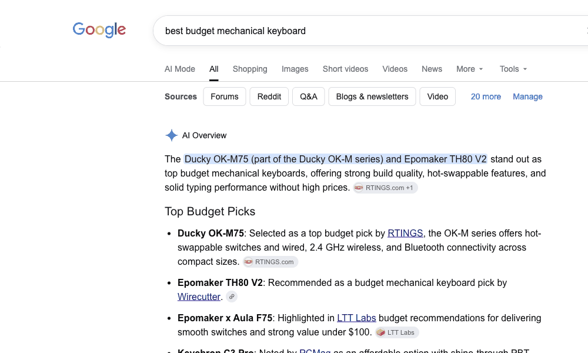

# Sourcepick

**Search only the sites you choose.** Forums, Reddit, official docs, papers, Korean communities, Japanese Q&A sites and more, on Google, DuckDuckGo or Brave Search.

[](https://github.com/dooly6276/sourcepick/actions/workflows/ci.yml)
[](https://github.com/dooly6276/sourcepick/releases/latest)
[](LICENSE)

**[Try the web app](https://dooly6276.github.io/sourcepick/)** · [Download the extension](https://github.com/dooly6276/sourcepick/releases/latest) | [한국어](README.ko.md)



Search engines bury forum threads, first-hand reviews and primary sources under SEO pages. Typing `site:reddit.com OR site:news.ycombinator.com OR ...` every time works, but nobody wants to. Sourcepick keeps those site lists for you as **sources** and applies them with one click.

- **One click on the results page.** The extension adds a row of source buttons to Google, DuckDuckGo and Brave Search. A click switches to that source; hold Ctrl or Shift (or turn on *Choose several sources*) to combine them. On a whole-web search you can turn on exclusions such as *No Pinterest*.
- **Search one site at a time.** When several sites are searched together, one big site can fill the page. Each site in the selection is one tap away.
- **35 built-in sources** for worldwide, Korean and Japanese sites, kept as plain JSON files that anyone can improve.
- **Your own sources.** Make a source from any list of domains or URL paths (`reddit.com/r/BuyItForLife` works) and share it as a link.
- **Works on phones too.** Add the web app to your home screen, then share selected text from any Android app to search it with your sources. Tested on Samsung Internet.
- **Address bar.** Type `sp` and a space in the address bar (extension), or register the web app as a search engine. Either way it follows the sources you selected last.
- **English, Korean and Japanese.** The interface follows your browser language, and each language starts with sources that fit it. Sources for every region are one tap away in Manage.
- **No account, no server, no tracking.** Settings stay in your browser. The only network request is the search itself, sent straight to the engine you picked.

## Install

| Where | How |
|---|---|
| Any phone or browser | Open the [web app](https://dooly6276.github.io/sourcepick/) and add it to your home screen. |
| Chrome, Edge, Whale, Brave, Opera | Chrome Web Store (coming soon). For now: download `sourcepick-chrome-*.zip` from the [latest release](https://github.com/dooly6276/sourcepick/releases/latest), unzip it, open `chrome://extensions`, turn on Developer mode and choose Load unpacked. |
| Firefox (desktop and Android) | Firefox Add-ons (coming soon). For now on desktop: download `sourcepick-firefox-*.zip`, open `about:debugging`, This Firefox, Load Temporary Add-on. |

On a phone, the web app is the way in: Samsung Internet, Chrome and Firefox on Android and Safari on iPhone can all add it to the home screen. On Android it also appears in the share sheet, so you can select text in any app and search it with your sources.

To build it yourself:

```bash
git clone https://github.com/dooly6276/sourcepick.git
cd sourcepick
npm run build        # writes dist/web, dist/chrome, dist/firefox
```

No dependencies. Node 18 or later is enough.

## How it works

A source is a list of sites. Choosing sources rewrites your query with search operators that every major engine understands:

```
mechanical keyboard site:reddit.com OR site:news.ycombinator.com -site:pinterest.com
```

The results page bar reads the operators back from the URL, so the buttons always show what is applied, and the page stays a normal search URL you can bookmark or share. Time filters, Google's Forums tab and other engine settings are kept.

Search engines ignore the end of a long query without saying so. In our November 2026 tests Google applied the first 32 words and sites (`OR` does not count), DuckDuckGo about 22 and Brave about 18. Sourcepick fits every search to the engine: sites to exclude are dropped first when sources are chosen (results come only from the chosen sites anyway), and when the chosen sites still do not fit, the app says how many are searched and offers the rest one site at a time. Bing is not supported yet because it showed a human verification page to our automated tests.

## Built-in sources

| Region | Sources |
|---|---|
| Worldwide | Forums, Reddit, Developers, Official docs, Papers, Video, Social, Product reviews, Wikis, Blogs & newsletters, Open source, Travel, Recipes, Design, Government & public, Universities, No Pinterest, No major news |
| Korea | Communities, Workplace, Naver & Daum cafes, Blogs, KnowledgeiN, Tech & gadgets, Gaming, Developers, Papers, Government, Law, Wikis, Recipes, No Korean news |
| Japan | Forums, Blogs, Developers |

Each one is a file in [`lenses/`](lenses). Missing a great site, or a whole country? See [CONTRIBUTING.md](CONTRIBUTING.md). It takes a JSON file and a pull request, or just [an issue](https://github.com/dooly6276/sourcepick/issues/new?template=new_source.yml) with the sites.

## Contributing

Sourcepick is small on purpose: plain JavaScript, no dependencies, one `npm test`. Good places to start:

- **Sources for your country or interests.** Most of the value is in good site lists. Issues labeled [`source`](https://github.com/dooly6276/sourcepick/labels/source) and [`good first issue`](https://github.com/dooly6276/sourcepick/labels/good%20first%20issue) are a fine first pull request.
- **Translations.** The interface has English, Korean and Japanese; adding a language is one block in `src/i18n.js`.
- **More engines and browsers.** Bing, Startpage, Ecosia, and a Safari extension for iPhone and Mac are open for anyone who wants them ([help wanted](https://github.com/dooly6276/sourcepick/labels/help%20wanted)).

[docs/ARCHITECTURE.md](docs/ARCHITECTURE.md) explains how the pieces fit and how to add an engine or a language. Questions and ideas are welcome in [Discussions](https://github.com/dooly6276/sourcepick/discussions).

## Project layout

```
lenses/            built-in sources, one JSON file each (global/, kr/, jp/)
src/core.js        query building for each engine, share links
src/store.js       settings (chrome.storage in the extension, localStorage on the web)
src/i18n.js        interface text (English, Korean, Japanese)
src/app/           the main screen, shared by the web app, the extension popup and its settings page
src/extension/     results-page bar, background script, store listing text
src/web/           address-bar and share-sheet redirect, service worker, web app manifest
scripts/           build, lens validation, domain check
tests/             node --test
```

```bash
npm test               # unit tests and lens validation
npm run check-domains  # checks that every site in lenses/ still responds (network)
npm run serve          # builds and serves the web app on http://127.0.0.1:8791
npm run package        # builds zip files for the extension stores
```

## Privacy

Sourcepick has no server and collects nothing. The extension asks only for `storage`, plus access to search result pages on Google, DuckDuckGo and Brave Search so it can show the source buttons there.

## License

[MIT](LICENSE)
